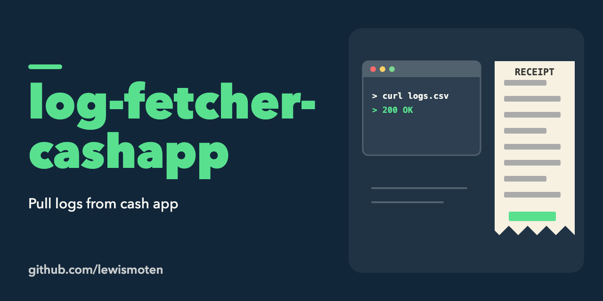

# log-fetcher-cashapp

Pull logs from Cash App.

This is an unfinished stub. `index.js` only prints "hello world" and keeps notes on the steps a fetch would need: open the web transaction history, enter the phone number, the code and the PIN, then download the CSV. Nothing is automated yet, and the project has not been touched since 2021.

```sh
npm start
```
